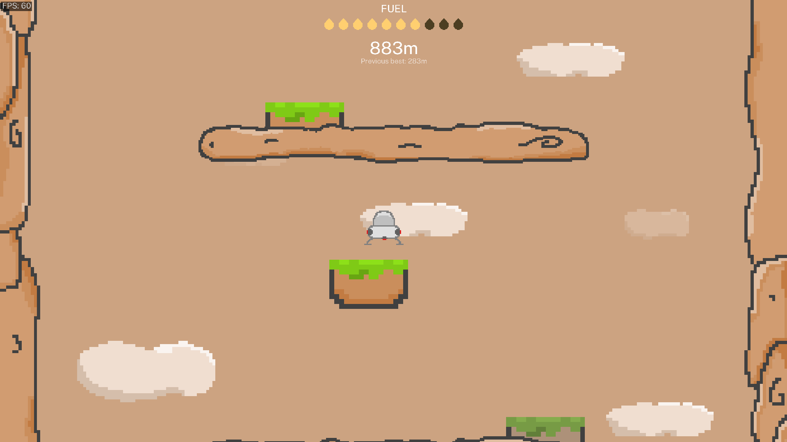

## Planet Escape
Use the left and right arrows or A and D to move. Landing on a new platform gives you fuel and changing directions mid-air uses fuel.

This is a small little demo game I developed to test out core engine features like graphics, sound, font rendering, gui etc.

You can download it through itch.io if you prefer: [https://sameerahmed99.itch.io/planet-escape](https://sameerahmed99.itch.io/planet-escape)

## Custom game engine written in C99 
The game serves as the first test for my custom game engine written in pure C using almost no third party libraries. The only third party libraries used are some of the stb libraries to load things like images and fonts. 

## Building and running (windows only)
Requires MinGW.
Simply run the build.bat file and then run build/PlanetEscape.exe. The project doesn't use a build system. 

While the engine has a platform abstraction layer, it only supports windows for now. Linux implementation is planned.

## Current list of features:
- platform abstraction layer (window management, memory functions, file system, graphics, audio)
- 2d graphics (opengl backend)
- 2d physics
- sound
- font rendering
- ui system

## Next goals
- 3d graphics
- 3d physics
- software renderer backend implementation
- asset packing system

## Credits
The engine code is highly inspired by rad debugger and ryan fleury, you will find many similarities. 

